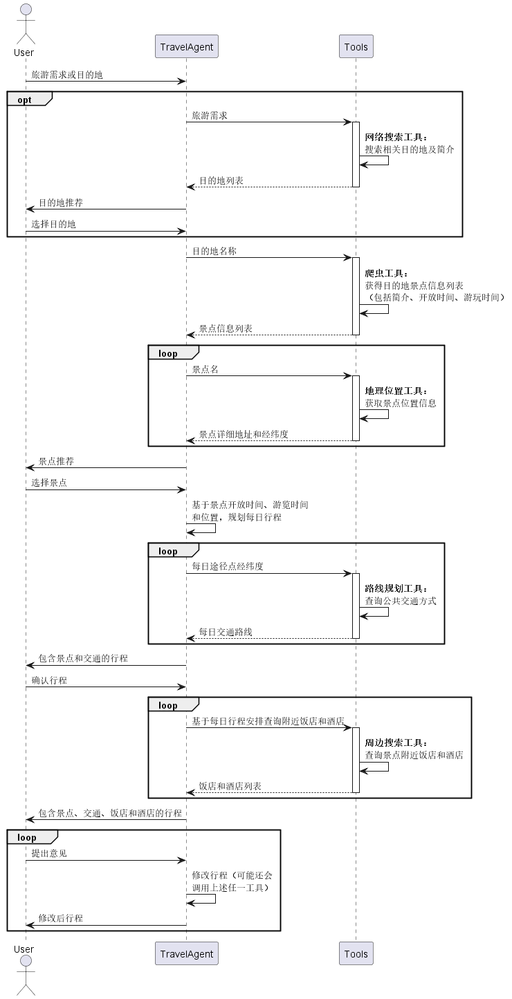

# 基于 LangGraph 的旅游规划助手

一个基于 **LangGraph** 构建的多轮对话式旅游规划 Agent。用户只需用自然语言描述出行需求，Agent 便会自主编排工具调用链，完成「目的地推荐 → 景点检索 → 位置解析 → 每日行程规划 → 交通查询 → 餐饮住宿推荐」的完整规划流程。

## 整体流程



Agent 与工具之间的交互时序（上图）大致如下：

1. **目的地推荐**：用户给出需求或目的地，必要时调用**网络搜索工具**推荐候选目的地供用户选择。
2. **景点检索**：调用**景点搜索工具**（爬取马蜂窝）获取目的地概览与景点列表（简介、开放时间、预计游玩时间）。
3. **位置解析**：循环调用**位置获取工具**（高德地理编码）把每个景点匹配到正确的经纬度。
4. **行程规划**：结合开放时间、游玩时长和地理位置，生成合理的每日行程。
5. **交通查询**：循环调用**路线规划工具**（高德）计算景点之间的公共交通方案与耗时。
6. **餐饮住宿**：循环调用**周边搜索工具**（高德）在当天行程点位附近搜索餐馆与酒店。
7. **迭代修改**：用户提出意见后，Agent 修改行程并可能再次调用上述任一工具。

## 功能特性

- 基于 LangGraph 的 **Agent ↔ Tools 循环**状态图（`agent` 节点决策、`tools` 节点执行）
- 通过 `InMemorySaver` 实现基于 `thread_id` 的多轮会话状态持久化
- 工具调用过程实时**流式输出**到前端 Debug 面板，方便观察 Agent 的思考与行动
- Gradio Web 界面，支持边生成边显示的对话体验
- 统一的 LLM 工厂（`LLMFactory`），便于扩展更多模型

## 技术栈

| 分类 | 技术 |
|---|---|
| Agent 编排 | LangGraph、LangChain |
| 大模型 | OpenAI `gpt-4o-mini`（经 `langchain-openai`） |
| 地图服务 | 高德地图 Web 服务 API（地理编码 / 路径规划 / 周边搜索） |
| 网页抓取 | Selenium + BeautifulSoup（马蜂窝景点数据） |
| 联网搜索 | DuckDuckGo Search |
| Web UI | Gradio |

## 目录结构

```
Travel_plan-bot/
├── webrun.py            # 程序入口：启动 Gradio Web 界面
├── req.txt              # Python 依赖清单
├── graph/               # LangGraph 状态图定义（节点、边、编译）
│   └── graph.py
├── agents/              # Agent 节点实现（同步 / 异步调用 LLM）
│   └── agents.py
├── states/              # 状态定义（PublicState）
│   └── state.py
├── models/              # LLM 工厂（按模型名创建实例）
│   └── factory.py
├── prompts/             # 系统提示词模板（角色 / 约束 / 工作流程）
│   └── main.py
├── tools/               # Agent 可调用的工具集
│   ├── web_search.py        # 网络搜索
│   ├── attractions.py       # 景点搜索（马蜂窝爬取）
│   ├── locations.py         # 地点经纬度
│   ├── transportation.py    # 路线规划
│   ├── nearby.py            # 周边 POI 搜索
│   └── save.py              # 信息保存
└── utils/               # 辅助函数（时间、会话历史保存）
    └── helper.py
```

## 快速开始

### 1. 环境要求

- Python 3.11
- Google Chrome（景点抓取基于 Selenium，需本机可用 Chrome）
- 一个**高德地图 Web 服务** API Key（[申请地址](https://lbs.amap.com/)）与**可用的大模型 API Key**

### 2. 安装依赖

```bash
pip install -r req.txt
```

### 3. 配置环境变量

在项目根目录创建 `.env`（该文件已被 `.gitignore` 忽略，不会提交）：

```dotenv
# 高德地图 Web 服务 Key
AMAP_API_KEY=your_amap_key

# 大模型（OpenAI 兼容）
OPENAI_API_KEY=your_api_key
# 如使用兼容网关，可额外指定：
# OPENAI_BASE_URL=https://your-endpoint/v1
```

### 4. 启动

```bash
python webrun.py
```

默认启动后访问 Gradio 提示的本地地址（通常为 `http://127.0.0.1:7860`），在对话框中输入你的旅行需求即可。左侧 Debug 面板会实时展示工具的调用过程。

## Agent 可用工具

| 工具 | 说明 | 依赖 |
|---|---|---|
| `web_search` | 搜索引擎检索，返回标题、链接与摘要 | DuckDuckGo |
| `get_attractions_information` | 获取目的地概览与景点列表（简介/开放时间/游玩时长） | Selenium + 马蜂窝 |
| `get_location_coordinate` | 将地点名称解析为经纬度（返回同名地点列表） | 高德地理编码 |
| `route_planning` | 规划公共交通路线，返回距离、耗时与费用 | 高德路径规划 |
| `search_nearby_poi` | 按关键字/类型搜索周边餐馆、酒店等 POI | 高德周边搜索 |
| `save_info_and_clear_history` | 保存当前获取到的有用信息 | — |

## 说明

- Agent 的行为由 `prompts/main.py` 中的系统提示词约束，遵循「任务 → 回顾 → 思考 → 计划」的显式推理格式。
- 模型名称在 `webrun.py` 中通过 `init_app(model_name="gpt-4o-mini")` 指定，可在 `models/factory.py` 中扩展更多模型支持。
- 会话历史由 `utils/helper.py` 写入本地 `history/` 目录（该目录已忽略，不在版本控制中）。
